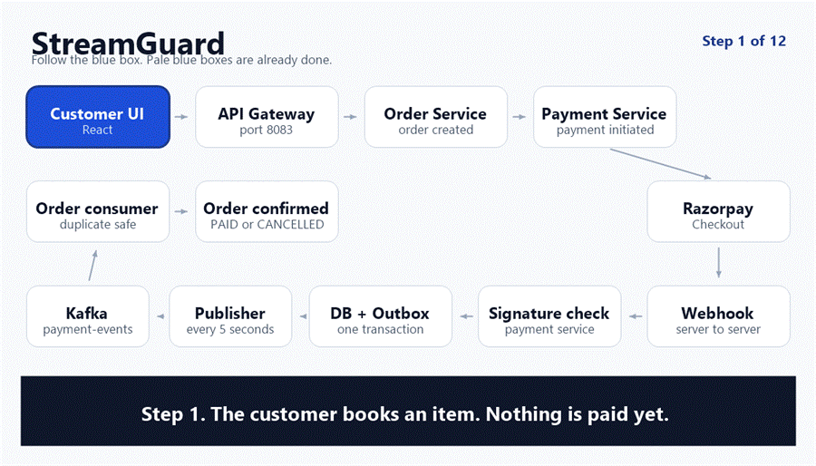

# StreamGuard frontend

Customer demonstration UI for the StreamGuard payment-reliability flow. The catalog is local mock data. Orders and payments are created through the API gateway using the contracts in the order and payment services.

Open this page in a Markdown preview to play the flow. The GIF loops through the implemented path: React UI, gateway, order, payment, Razorpay Checkout, webhook, signature check, database plus outbox, publisher, Kafka, order consumer, and the confirmed order. It is a diagram, not a live trace.



The repository README at `../README.md` uses the same animation and the static Mermaid diagram. Regenerate the GIF from this folder with:

```bash
powershell -NoProfile -ExecutionPolicy Bypass -File .\scripts\generate-payment-flow-gif.ps1
node .\scripts\ensure-gif-loop.cjs
```

## Setup

```bash
cd Frontend
npm install
copy .env.example .env
npm run dev
```

The app runs at `http://localhost:5173`.

`VITE_API_BASE_URL` is `http://localhost:8083`. Sign in or register before booking. The gateway expects `Authorization: Bearer` on order and payment calls.

Set `VITE_RAZORPAY_KEY_ID` to the public Razorpay key id before using Pay Now. Do not put the key secret or webhook secret in this app.

## Screens

1. Product listing with Book.
2. Product summary.
3. Order creation loading and error states.
4. Order created in `PENDING`, with Pay Now.
5. Razorpay Checkout opened from the payment response.
6. Processing state that polls `GET /api/orders/{orderId}`.
7. Confirmation only when order status is `PAID`.
8. Checkout dismissed, poll timeout, and `CANCELLED` after a failed payment event.

The browser never calls `POST /api/webhooks/razorpay`. A Checkout handler or `payment.failed` callback only starts polling. It is not treated as confirmation.

## Endpoint inventory

Gateway routes are explicit: `/api/orders/**` and `/api/payments/**`. Auth is `POST /api/auth/register` and `POST /api/auth/login`.

| Method | Gateway path | Request | Response | Owner | Frontend use |
| --- | --- | --- | --- | --- | --- |
| POST | `/api/auth/register` | `username`, `email`, `password` | `{ "token": "<jwt>" }` | `AuthController` | Create account |
| POST | `/api/auth/login` | `email`, `password` | `{ "token": "<jwt>" }` | `AuthController` | Sign in |
| POST | `/api/orders` | `numberOfItems`, `amount`, `currency`. Bearer token required. Gateway injects identity. Returns 201. | `id`, `customerId` (email), `numberOfItems`, `totalAmount`, `currency`, `status`, `createdAt`, `updatedAt` | `OrderController` | Book |
| GET | `/api/orders/{orderId}` | Path `orderId` (UUID). Bearer token required. | Same order body. Missing or foreign orders return 404. | `OrderController.getOrderById` | Load the order and poll until `PAID` or `CANCELLED` |
| POST | `/api/payments` | Body `orderId`. Headers `Authorization` and `Idempotency-Key`. Returns 201. | `paymentId`, `orderId`, `razorpayOrderId`, `amount`, `currency`, `status` | `PaymentController` | Pay Now, then Razorpay Checkout |
| GET | `/api/payments/{paymentId}` | Path `paymentId`. Bearer token required. | Same payment body. | `PaymentController` | Poll payment status while waiting |
| POST | `/api/webhooks/razorpay` | Raw body plus `X-Razorpay-Signature`. Not routed by the gateway config. | Plain text | `PaymentWebhookController` | Not called by this app |

Order status values from `OrderStatus`: `PENDING`, `PAID`, `CANCELLED`. New orders are stored as `PENDING`. The order consumer maps payment `SUCCESS` to `PAID` and `FAILED` to `CANCELLED`.

Payment status values from `PaymentStatus`: `PENDING`, `SUCCESS`, `FAILED`.

Direct service ports, not used by the UI: order `8086`, payment `8084`, gateway `8083`.

## Backend integration gaps

- **No Razorpay key id in `PaymentResponseDTO`.** Checkout needs the public key. It is supplied with `VITE_RAZORPAY_KEY_ID`. The key secret stays in `razorpay.key.secret` on the payment service.
- **No product field on the order.** The UI keeps the mock catalog item in `sessionStorage` for display.
- **`POST /api/webhooks/razorpay` is not a gateway route.** Razorpay must call the payment service directly. The browser does not call it.
- **`order.order.dto.PaymentRequestDTO` is not exposed** by `OrderController`. Payment initiation is only `POST /api/payments`.

Paths live in `src/api/endpoints.js` so they can be changed in one place.
