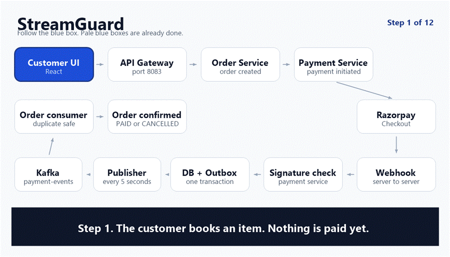
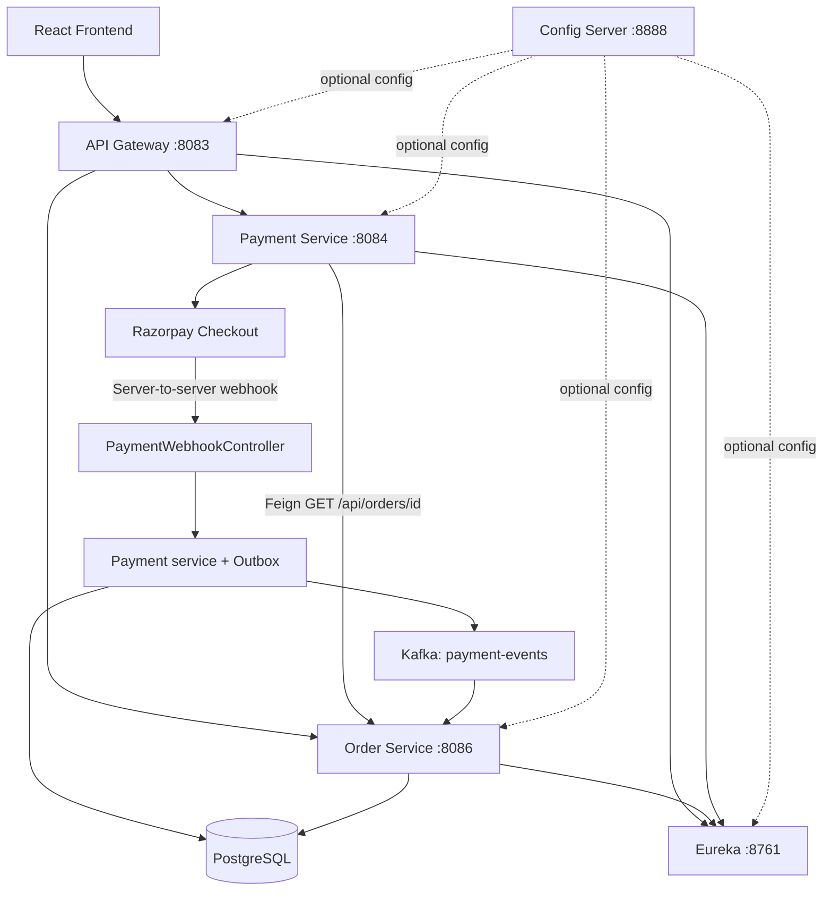

# StreamGuard — Event-Driven Payment Microservices

StreamGuard is an event-driven payment system built with Spring Boot microservices. It integrates Razorpay for payment processing, Apache Kafka for asynchronous event communication, PostgreSQL for persistence, and Spring Cloud for service discovery, centralized configuration, and API routing.

The React client books a product, creates an order, starts a payment, and waits for the backend order status. Payment success is never decided from the browser Checkout callback alone.

Backend service images are published to Docker Hub. The frontend is packaged with Docker and Nginx.



The animation above walks the implemented payment path one step at a time. It is a diagram, not a live trace, and it does not invent latency or success-rate figures. If the GIF does not play, use the Mermaid diagram below.

## Architecture

StreamGuard uses centralized routing, service discovery, and asynchronous payment outcome delivery.

### Services

| Service | Port | Description |
| --- | ---: | --- |
| Config Server | 8888 | Centralized configuration |
| Eureka Server | 8761 | Service registration and discovery |
| API Gateway | 8083 | JWT auth, routing, and authenticated identity injection |
| Payment Service | 8084 | Razorpay initiation, webhook verification, outbox publishing |
| Order Service | 8086 | Order ownership and payment-event consumption |
| PostgreSQL | 5435 | Persistent storage |
| Kafka | 9092 | `payment-events` topic |
| PgAdmin | 5051 | PostgreSQL administration |
| Frontend | 3000 | React client (Vite locally on 5173; Nginx container on 3000) |

### System diagram



## Tech stack

- Java and Spring Boot
- Spring Cloud Gateway, Eureka, and Config Server
- Spring Data JPA and Hibernate
- PostgreSQL
- Apache Kafka
- Razorpay
- JWT authentication on the gateway
- Transactional Outbox with retry and `FAILED` terminal status
- Docker, Spring Boot Buildpacks, and Docker Hub
- React, Vite, Axios, Tailwind CSS, and Nginx

## Core features

### Microservices

- Independent Order and Payment services
- API Gateway for centralized routing
- Eureka-based discovery
- Spring Cloud Config with optional native import

### Authentication and identity

- Register and login on the gateway: `POST /api/auth/register`, `POST /api/auth/login`
- JWT returned as `{ "token": "..." }`
- Authenticated routes require `Authorization: Bearer <jwt>`
- The gateway strips any client-supplied `X-User-Id` and injects the JWT subject (email)
- Orders are owned by that identity; the frontend does not send a demo customer UUID

### Payment processing

- Razorpay order creation in Payment Service
- Server-to-server webhook verification with HMAC-SHA256
- Payment status API: `GET /api/payments/{paymentId}`
- Idempotent payment creation with `Idempotency-Key`

### Event-driven communication

- Kafka topic `payment-events`
- Transactional Outbox: payment update and outbox insert commit together
- Outbox publisher with exponential backoff, retry count, last error, and `FAILED` after the configured limit
- Order consumer ignores duplicate `paymentId` values using `processed_payment_events`

### Containerization

- Backend images built with Spring Boot Buildpacks
- Images published to Docker Hub
- Frontend containerized with Node build + Nginx
- Compose orchestration under `docker-compose.yaml`

## Payment lifecycle

1. Client signs in through the gateway and receives a JWT.
2. Book sends `numberOfItems`, `amount`, and `currency`. The gateway adds `X-User-Id`.
3. Order Service stores the order as `PENDING` for that identity.
4. Pay Now calls Payment Service with `{ "orderId" }` and `Idempotency-Key`.
5. Payment Service loads the caller's order, creates a Razorpay order, and returns checkout details.
6. The browser opens Razorpay Checkout. Closing Checkout is not confirmation.
7. Razorpay posts to `POST /api/webhooks/razorpay`. The browser never calls this route.
8. Signature, amount, and currency are verified. Payment status becomes `SUCCESS` or `FAILED`.
9. Payment status and an outbox row are saved in one database transaction.
10. The publisher sends the event to Kafka, then marks the outbox row `PUBLISHED`. Publish failures retry with backoff and become `FAILED` after `streamguard.outbox.max-retries`.
11. Order Service consumes the event once and sets the order to `PAID` or `CANCELLED`.
12. The UI polls payment status and order status. Confirmation is only order `PAID`.

Illustrative event body:

```json
{
  "paymentId": "00000000-0000-4000-8000-000000000010",
  "orderId": "00000000-0000-4000-8000-000000000001",
  "amount": 4999.00,
  "currency": "INR",
  "status": "SUCCESS"
}
```

## Transactional outbox

`PaymentServiceImpl` is `@Transactional`. The webhook updates `payments` and inserts `outbox_events` before that transaction commits. Kafka publication is outside the database transaction.

Outbox statuses: `PENDING`, `PUBLISHED`, `FAILED`.

`PUBLISHED` means Kafka acknowledged the record. It does not mean Order Service has processed it.

Retry settings in `payment/src/main/resources/application.properties`:

```properties
streamguard.outbox.max-retries=8
streamguard.outbox.initial-backoff-ms=5000
streamguard.outbox.max-backoff-ms=300000
streamguard.outbox.poll-interval-ms=5000
```

There is no Kafka dead-letter topic. Exhausted rows remain in `outbox_events` as `FAILED` with `lastError`.

## Endpoint inventory

Gateway routes from `gateway/src/main/resources/application.properties`:

- `/api/orders/**` → Order Service
- `/api/payments/**` → Payment Service
- `/api/webhooks/**` → Payment Service
- `/api/auth/**` served by the gateway

| Method | Path | Notes |
| --- | --- | --- |
| POST | `/api/auth/register` | `username`, `email`, `password` → `{ token }` |
| POST | `/api/auth/login` | `email`, `password` → `{ token }` |
| POST | `/api/orders` | Bearer required. Body: `numberOfItems`, `amount`, `currency`. Identity from `X-User-Id`. |
| GET | `/api/orders/{orderId}` | Bearer required. Returns 404 for another user's order. |
| POST | `/api/payments` | Bearer + `Idempotency-Key`. Body: `{ "orderId" }`. |
| GET | `/api/payments/{paymentId}` | Bearer required. Ownership checked through the related order. |
| POST | `/api/webhooks/razorpay` | Razorpay only. `X-Razorpay-Signature`. Permit-all on the gateway. |

Order statuses: `PENDING`, `PAID`, `CANCELLED`.

Payment statuses: `PENDING`, `SUCCESS`, `FAILED`.

## Docker Hub images

| Service | Docker Image |
| --- | --- |
| Config Server | [streamguard-config-server](https://hub.docker.com/r/salmanfaris21/streamguard-config-server) |
| Eureka Server | [streamguard-eureka](https://hub.docker.com/r/salmanfaris21/streamguard-eureka) |
| Payment Service | [streamguard-payment](https://hub.docker.com/r/salmanfaris21/streamguard-payment) |
| Order Service | [streamguard-order](https://hub.docker.com/r/salmanfaris21/streamguard-order) |
| API Gateway | [streamguard-gateway](https://hub.docker.com/r/salmanfaris21/streamguard-gateway) |
| Frontend | [streamguard-frontend](https://hub.docker.com/r/salmanfaris21/streamguard-frontend) |

## Building backend Docker images

Spring Boot services can use Buildpacks:

```powershell
.\mvnw spring-boot:build-image -DskipTests "-Dspring-boot.build-image.imageName=salmanfaris21/streamguard-payment"
```

```powershell
docker push salmanfaris21/streamguard-payment
```

Use the same pattern for `streamguard-order`, `streamguard-gateway`, `streamguard-eureka`, and `streamguard-config-server`.

## Frontend containerization

The React app is built with Node and served by Nginx. Dockerfile: `Frontend/Dockerfile`.

```powershell
cd Frontend
docker build -t salmanfaris21/streamguard-frontend .
docker push salmanfaris21/streamguard-frontend
```

## Docker Compose

Compose definition: `docker-compose.yaml`.

It starts PostgreSQL, PgAdmin, Kafka, Config Server, Eureka, Payment, Order, Gateway, and Frontend.

Sensitive values come from the environment / `.env` next to the compose file:

```env
STREAMGUARD_JWT_SECRET=your_jwt_secret
RAZORPAY_KEY_ID=your_key_id
RAZORPAY_KEY_SECRET=your_key_secret
RAZORPAY_WEBHOOK_SECRET=your_webhook_secret
```

Do not commit real secrets. Local compose still contains demo Postgres/pgAdmin credentials for development only.

### Start

```powershell
cd payment
docker compose pull
docker compose up -d
```

If you are building locally instead of pulling Hub images, use `docker compose up -d --build` from the directory that matches the compose `build:` contexts.

### Status and logs

```powershell
docker compose ps
docker compose logs -f
```

### Stop

```powershell
docker compose down
```

## Local development without full Compose

1. Start Postgres, Kafka, and PgAdmin:

```powershell
docker compose -f payment/docker-compose.yaml up -d postgres kafka pgadmin
```

2. Start Eureka (`service-reg`, 8761). Config Server (8888) is optional.
3. Export `STREAMGUARD_JWT_SECRET`, `RAZORPAY_KEY_ID`, `RAZORPAY_KEY_SECRET`, and `RAZORPAY_WEBHOOK_SECRET`.
4. Start Payment (8084), Order (8086), and Gateway (8083).
5. Point the Razorpay webhook at the payment webhook route, not the browser.
6. Start the UI:

```powershell
cd Frontend
npm install
copy .env.example .env
npm run dev
```

Open `http://localhost:5173`. Set:

```env
VITE_API_BASE_URL=http://localhost:8083
VITE_RAZORPAY_KEY_ID=your_public_key_id
```

Never put the Razorpay key secret or webhook secret in the frontend.

## Access URLs

| Service | URL |
| --- | --- |
| Frontend (Compose/Nginx) | http://localhost:3000 |
| Frontend (Vite local) | http://localhost:5173 |
| API Gateway | http://localhost:8083 |
| Payment Service | http://localhost:8084 |
| Order Service | http://localhost:8086 |
| Eureka Dashboard | http://localhost:8761 |
| Config Server | http://localhost:8888 |
| PgAdmin | http://localhost:5051 |

## Demo walkthrough

1. Register or sign in.
2. Book an available product.
3. Confirm the order is `PENDING`.
4. Pay Now and complete or close Razorpay Checkout.
5. Watch payment status and order status. Confirmation appears only when the order is `PAID`.
6. A `CANCELLED` order cannot be paid again; book a new item to retry.

## Animation asset

Source GIF: `docs/assets/streamguard-payment-flow.gif`

Regenerate from `Frontend`:

```powershell
powershell -NoProfile -ExecutionPolicy Bypass -File .\scripts\generate-payment-flow-gif.ps1
node .\scripts\ensure-gif-loop.cjs
```

## Limitations and roadmap

- Checkout still needs the public Razorpay key in `VITE_RAZORPAY_KEY_ID` because `PaymentResponseDTO` does not return it.
- The catalog is frontend mock data; orders do not store a product name.
- Order and Payment share one Postgres database in the current local/docker setup; tables remain separate.
- Exhausted outbox rows are `FAILED` in the database. There is no Kafka dead-letter topic.
- Changing `orders.customer_id` from UUID to email requires a local schema refresh if old rows exist.
- Planned next steps: Kubernetes deployment, CI/CD, monitoring/observability, and stronger multi-environment resilience.

---

StreamGuard — reliable payment workflows through event-driven microservices.
