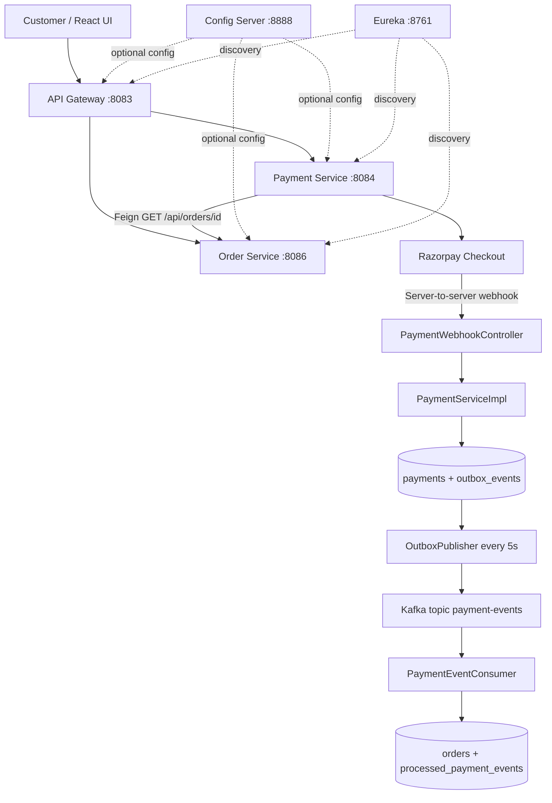

# StreamGuard

StreamGuard follows one payment from a React checkout through an API gateway, Razorpay, a verified webhook, a transactional outbox, and Kafka, until the order service records the outcome.

The animation below is the implemented path, one component at a time. It is a diagram, not a live trace, and it does not show latency or success rates.


## Feature highlights

- A small React catalog. Booking creates a real order. The UI does not invent a paid order locally.
- Payment initiation loads the order in the payment service and creates the Razorpay order there. The browser only receives the resulting checkout details.
- Razorpay calls `POST /api/webhooks/razorpay` on the payment service. The React app never calls that route.
- The webhook signature is checked before payment state changes.
- The payment update and the outbox insert are in one payment-service transaction.
- The gateway takes the JWT subject (email), strips any client `X-User-Id` header, and injects the authenticated identity itself.
- Orders belong to that identity. The UI does not send a customer UUID.
- A scheduled publisher sends pending outbox rows to Kafka, retries with backoff, marks them `PUBLISHED` after Kafka acknowledges, and marks them `FAILED` after the retry limit.
- The order consumer updates the order once per payment id and ignores a repeated delivery of that same id.
- The UI polls payment status while waiting, and shows confirmation only when the order status is `PAID`.

## Tech stack

| Piece | What the repository uses |
| --- | --- |
| Frontend | React, JSX, React Router, Axios, Tailwind CSS, Vite |
| Gateway | Spring Cloud Gateway server WebMVC, Eureka client, port 8083 |
| Order service | Spring Boot, JPA, Kafka consumer, port 8086 |
| Payment service | Spring Boot, JPA, Razorpay Java client, Feign, scheduled outbox publisher, port 8084 |
| Discovery | Eureka server in `service-reg`, port 8761 |
| Config | Spring Cloud Config native profile, port 8888, optional import |
| Data | PostgreSQL 18 from `payment/docker-compose.yaml`, host port 5435 |
| Messaging | Apache Kafka from that same compose file, host port 9092 |
| Provider | Razorpay Checkout and Razorpay webhooks |

## Architecture



If the animation does not play, the diagram above is the same path.

## What each service owns

- **React UI** (`Frontend`): mock catalog, sign-in, order creation, Pay Now, Razorpay Checkout, payment-status polling, then order confirmation. Checkout callbacks are not treated as confirmation.
- **API gateway** (`gateway`): JWT login/register, route forwarding, and `X-User-Id` injection from the JWT subject.
- **Order service** (`order`): creates orders as `PENDING` for the gateway-injected identity, returns only that user's orders, and consumes `payment-events`.
- **Payment service** (`payment`): creates a payment for a `PENDING` order, creates the Razorpay order, verifies the webhook, exposes payment status by id, and writes the outbox row.
- **Outbox publisher**: loads due `PENDING` rows, publishes them, retries with exponential backoff, and sets `FAILED` after `streamguard.outbox.max-retries`.
- **Order consumer**: maps `SUCCESS` to `PAID` and `FAILED` to `CANCELLED`.

`PUBLISHED` means the publisher received a Kafka acknowledgement. It does not mean the order service has processed the event. Those are separate transactions.

## Payment lifecycle

1. The customer clicks Book. The UI sends `numberOfItems`, `amount`, and `currency`. The gateway adds `X-User-Id` from the JWT subject.
2. `OrderServiceImpl` saves the order for that identity. `@PrePersist` sets status `PENDING`.
3. The customer clicks Pay Now. The UI sends `{ "orderId" }` and an `Idempotency-Key` header.
4. The payment service loads the order with Feign (`OrderClient` calls `GET /api/orders/{orderId}`).
5. A reused idempotency key returns the existing payment when the order, amount, and currency match. A reused key with different details returns HTTP 409.
6. Payment is rejected unless the order is `PENDING`.
7. The service saves a `PENDING` payment, creates a Razorpay order for the order amount in paise, and stores `razorpayOrderId`.
8. The browser opens Razorpay Checkout with that order id, amount, and currency.
9. Razorpay posts the webhook to the payment service. The UI does not.
10. `PaymentWebhookController` checks `X-Razorpay-Signature` with HMAC-SHA256. A bad signature returns HTTP 400 and does not change payment state.
11. `payment.captured` / `captured` becomes `SUCCESS`. `payment.failed` / `failed` becomes `FAILED`. Other events return without a status change.
12. Amount and currency are compared with the stored payment. A mismatch is rejected.
13. If the payment is already in that status, processing returns without another outbox row.
14. Otherwise the payment update and a new `outbox_events` row commit together. The row status is `PENDING`. The event type is `PAYMENT_SUCCESS` or `PAYMENT_FAILED`.
15. `OutboxPublisher` publishes the payload to Kafka topic `payment-events`, with the order id as the message key, and sets the outbox row to `PUBLISHED` after acknowledgement. A publish failure increments `retryCount`, stores `lastError` and `lastAttemptedAt`, and waits until `nextAttemptAt`. After `streamguard.outbox.max-retries` the row is stored as `FAILED`. There is no Kafka dead-letter topic.
16. `PaymentEventConsumer` ignores the event when `processed_payment_events` already contains that `paymentId`. Otherwise it updates the order and saves the processed-payment row in the same consumer transaction.
17. The UI polls `GET /api/payments/{paymentId}` for payment status and `GET /api/orders/{orderId}` for confirmation. Confirmation is only `PAID`. `CANCELLED` is the failed order outcome.

Illustrative event body, matching `PaymentEvent` fields:

```json
{
  "paymentId": "00000000-0000-4000-8000-000000000010",
  "orderId": "00000000-0000-4000-8000-000000000001",
  "amount": 4999.00,
  "currency": "INR",
  "status": "SUCCESS"
}
```

## Transactional outbox

`PaymentServiceImpl` is annotated `@Transactional`. The webhook handler updates `payments` and inserts `outbox_events` before that transaction commits. Kafka is outside the database transaction.

Outbox statuses used by this code are `PENDING`, `PUBLISHED`, and `FAILED`. `publishedAt` is set when the row becomes `PUBLISHED`. Failed rows stay in `outbox_events` with the last error so they can be inspected without a Kafka dead-letter topic.

Retry settings in `payment/src/main/resources/application.properties`:

```
streamguard.outbox.max-retries=8
streamguard.outbox.initial-backoff-ms=5000
streamguard.outbox.max-backoff-ms=300000
streamguard.outbox.poll-interval-ms=5000
```

## Kafka and the consumer

- Topic: `payment-events`
- Producer: `PaymentEventProducer`
- Consumer group: `order-service-group`
- Consumer class: `PaymentEventConsumer`
- Producer type headers are turned off (`spring.json.add.type.headers=false`). The consumer uses `spring.json.use.type.headers=false` and defaults the JSON type to `com.example.order.order.event.PaymentEvent`.

Duplicate handling that is actually implemented:

- The consumer returns immediately when `ProcessedPaymentEventRepository.existsByPaymentId` is true.
- `processed_payment_events.payment_id` has a unique constraint, `uk_processed_payment_id`.
- The payment service also skips a webhook whose new status equals the stored status, so it does not write a second outbox row for that same outcome.

If Kafka is down, the row stays `PENDING` until `nextAttemptAt`. After the retry limit it is `FAILED` and is not published again. There is no Kafka dead-letter topic. If the consumer throws, Spring Kafka's container error handling applies; this repository does not add a custom consumer error handler.

## Endpoint inventory

Controller paths below are the gateway routes in `gateway/src/main/resources/application.properties`. Discovery locator is disabled. `/api/orders/**` goes to the order service and `/api/payments/**` goes to the payment service. Auth is handled on the gateway.

| Method | Gateway path | Request | Response | Owner | Used by |
| --- | --- | --- | --- | --- | --- |
| POST | `/api/auth/register` | `username` (3–30), `email`, `password` (at least 8). HTTP 200. | `{ "token": "<jwt>" }` | `AuthController` | Registration |
| POST | `/api/auth/login` | `email`, `password`. HTTP 200. | `{ "token": "<jwt>" }` | `AuthController` | Sign in |
| POST | `/api/orders` | `numberOfItems`, `amount`, `currency`. Bearer token required. Gateway injects `X-User-Id`. HTTP 201. | `id`, `customerId` (JWT email), `numberOfItems`, `totalAmount`, `currency`, `status`, `createdAt`, `updatedAt` | `OrderController` | Book |
| GET | `/api/orders/{orderId}` | Order UUID. Bearer token required. Returns 404 if the order is not the caller's. | Same order body. | `OrderController` | Order screen and confirmation polling |
| POST | `/api/payments` | Body `orderId` UUID. Headers `Authorization: Bearer <jwt>` and `Idempotency-Key`. HTTP 201. | `paymentId`, `orderId`, `razorpayOrderId`, `amount`, `currency`, `status` | `PaymentController` | Pay Now |
| GET | `/api/payments/{paymentId}` | Payment UUID. Bearer token required. Ownership checked through the related order. | Same payment body. | `PaymentController` | Payment-status polling |
| POST | `/api/webhooks/razorpay` | Raw body and `X-Razorpay-Signature`. This route is not declared on the gateway. | Plain text | `PaymentWebhookController` | Razorpay only. Not the browser. |

Order statuses: `PENDING`, `PAID`, `CANCELLED`.

Payment statuses: `PENDING`, `SUCCESS`, `FAILED`.

Direct ports, for service-to-service calls only: order 8086, payment 8084. The UI is written against the gateway paths.

## Local setup

From the repository root:

1. Start PostgreSQL, pgAdmin, and Kafka.

```bash
docker compose -f payment/docker-compose.yaml up -d
```

Host ports: Postgres `5435`, Kafka `9092`, pgAdmin `5051`. The compose file contains local demo credentials. Use those only on your machine, and change them before any shared environment. Do not copy them into frontend config.

2. Start Eureka (`service-reg`, port 8761). Config Server on port 8888 is optional; service imports use `optional:configserver:http://localhost:8888`. Its native search path is `~/streamguard-config/`.
3. Export Razorpay settings for the payment service: `RAZORPAY_KEY_ID`, `RAZORPAY_KEY_SECRET`, `RAZORPAY_WEBHOOK_SECRET`. Point the Razorpay webhook at the payment service webhook route, not at the browser.
4. Start `payment` (8084), `order` (8086), and `gateway` (8083). Order and payment both use database `streamguard` on `localhost:5435` in their local properties. Tables are separate: `orders`, `payments`, `outbox_events`, `processed_payment_events`.
5. Start the UI:

```bash
cd Frontend
npm install
copy .env.example .env
npm run dev
```

Open `http://localhost:5173`. Set `VITE_API_BASE_URL` to `http://localhost:8083`. The UI sends `Authorization: Bearer` on order and payment calls. Set `VITE_RAZORPAY_KEY_ID` to the public key id. Never put the key secret or webhook secret in `Frontend`. Restart the gateway after the CORS change so the browser on port 5173 can call port 8083.

`spring.jpa.hibernate.ddl-auto=create-drop` is set on order and payment, so local tables are dropped when those processes stop.

## Environment example

```bash
RAZORPAY_KEY_ID=
RAZORPAY_KEY_SECRET=
RAZORPAY_WEBHOOK_SECRET=

# Frontend/.env
VITE_API_BASE_URL=http://localhost:8083
VITE_RAZORPAY_KEY_ID=
```

## Demo walkthrough

1. Register or sign in. The gateway returns a JWT, and the UI stores it.
2. Open the product list and book an available item, such as Harbor Headphones.
3. Read the order id and `PENDING` status returned by the order service.
4. Click Pay Now. Complete or close Razorpay Checkout.
5. Stay on the order screen. It polls payment status and the order. Closing Checkout, or a Checkout success callback, does not mark the order paid.
6. After the webhook, outbox publish, and consumer run, the order status becomes `PAID` or `CANCELLED`.
7. A `CANCELLED` order cannot be paid again. Payment initiation allows only `PENDING` orders, so book a new item to retry.

## Screenshots

UI screenshots are not stored in the repository. The animated diagram at the top of this file is the flow asset: `docs/assets/streamguard-payment-flow.gif`.

Regenerate it from `Frontend` with:

```bash
powershell -NoProfile -ExecutionPolicy Bypass -File .\scripts\generate-payment-flow-gif.ps1
node .\scripts\ensure-gif-loop.cjs
```

## Limitations and roadmap

- `PaymentResponseDTO` does not include the Razorpay key id. Checkout uses `VITE_RAZORPAY_KEY_ID`.
- Orders do not store a product id. The catalog is frontend mock data.
- Local order and payment services share one Postgres database in their property files.
- Changing `orders.customer_id` from UUID to email requires a local schema refresh if old rows exist.
